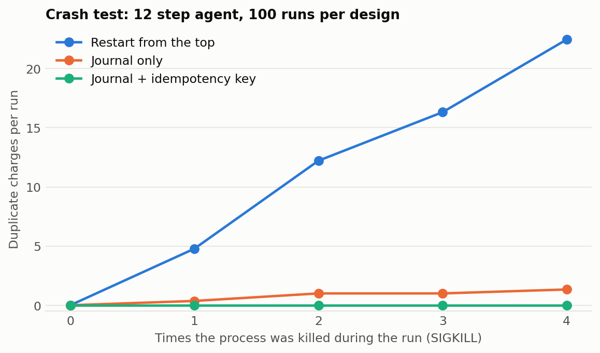

# resumable

Durable execution for AI agents. Long agent runs die: the process crashes, the machine restarts, the API goes down. Rerunning from the top repeats every email, payment and paid LLM call. With resumable, the agent stays ordinary Python and each side effect goes through a journaled step, so a restarted run skips what already finished.

```python
from resumable import Budget, run_agent

def agent(run):
    plan = run.step("plan", call_llm, "Plan the refund", cost=0.002)
    run.step("refund", issue_refund, plan["order_id"], retries=5)
    return run.step("email", send_email, plan["customer"])

# Run this again after a crash and it picks up where it stopped.
run_agent("runs.db", "ticket-4812", agent, Budget(max_cost=1.00))
```

Every step function receives an `idempotency_key` that stays the same across retries and restarts.

## Does it work under real crashes?

[`benchmarks/chaos.py`](benchmarks/chaos.py) runs a 12 step agent in a separate process, kills it with `SIGKILL` at random moments, and restarts it until it finishes. Each step charges a fake payment ledger, a separate SQLite file. Ground truth is exactly one charge per step, across 100 runs per design.

| Design | Kills | Runs with duplicates | Mean duplicate charges per run | Missing charges |
| :--- | ---: | ---: | ---: | ---: |
| Restart from the top | 226 | 77 of 100 | 12.59 | 0 |
| Journal only | 158 | 51 of 100 | 0.63 | 0 |
| **Journal + idempotency key** | 134 | 0 of 100 | 0.00 | 0 |

<picture>
<source media="(prefers-color-scheme: dark)" srcset="results/charts/crash-test-dark.png" />

</picture>

**The middle row is the important one.** A journal alone can't give you exactly once. If the process dies after the charge happens and before the result is saved, the step runs again on restart. Only the external system can close that gap, by deduping on the key, so a tool that doesn't support idempotency keys can still double fire.

The fake ledger is a local stand in, and the kill timing is random rather than exhaustive, so this is strong evidence and not a proof. Designs were run one after another, so their kill counts differ. It also doesn't cover disk failure.

## What you get

* **Crash recovery** from a SQLite journal in WAL mode with full sync.
* **Retries with full jitter.** Timeouts and connection errors retry, and other errors fail fast so a bad request isn't repeated. Pass `retry_if` to change this.
* **Budgets that survive restarts**, so a crash loop can't spend past your cost or step limit.
* **Replay safety.** If the code changes and a resumed run asks for different steps than the journal holds, it raises `NonDeterministic` rather than feeding a stale result into new logic.
* **Parallel steps.** `run.map("fetch", fn, items, workers=8)` keeps order, journals each item, and only reruns what's missing.
* **Human approval.** `run.wait_for("approve")` raises `Paused` and survives restarts, and `signal(db, run_id, "approve", True)` lets the run continue.
* **History** of each step's attempts, cost and duration, plus an error log.

Each durable step adds about 0.08 ms on an Apple M5 SSD. macOS may not flush all the way to the disk platter on sync, so a power loss there is a weaker guarantee than the process kills tested here.

## Limitations

* **Agents must be deterministic between steps.** Randomness or the current time belongs inside a step.
* **Step results must be JSON serializable.**
* **Single machine.** SQLite means no fleet of workers. For distributed durable execution, use [Temporal](https://temporal.io) or similar. This is a small library for when that's too much infrastructure.
* **Not yet used with a live LLM.** The benchmark's agent is scripted.

## Run it

```
pip install -e ".[dev]"
pytest
python -m benchmarks.chaos
```

No dependencies beyond the Python standard library.
